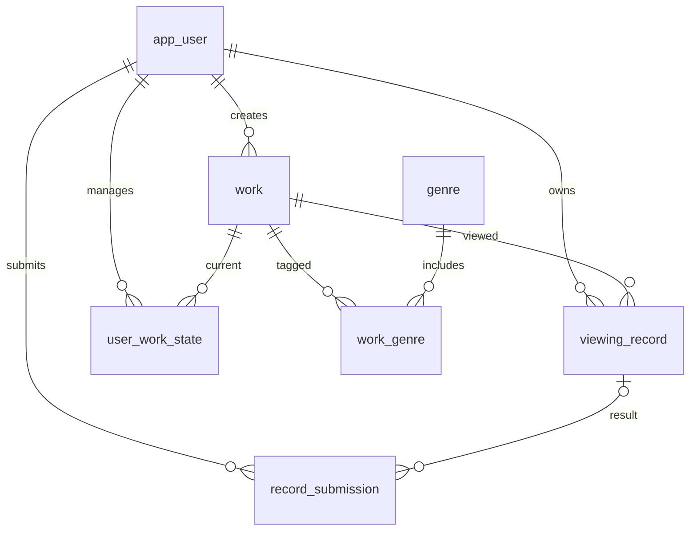

# 설계와 연결 계약

## 평가·통계 화면 보완 — 2026-11-10

- 기록 상세는 이 감상의 평점·이전 유효 평점·서버가 계산한 차이를 함께 표시한다. 미평점은 ‘평점 비교 없음’으로 표시하며 비교 기준 날짜·직전 감상 원문은 추정하지 않는다.
- 작성/수정 오류에서는 기존 서버 메시지의 감상일·평점·감상평 접두어에 해당하는 항목만 `aria-invalid`·도움말·오류 이동 링크로 연결한다. 서버 검증 규칙은 복제하지 않는다. 옵션에 없는 제출 평점도 안전하게 표시·보존하며, 날짜 오류 때는 텍스트 입력으로 원래 문자열을 보존한다.
- 409 초안/version과 최신 기록의 분리는 유지한다. 최신 감상평이 빈 문자열일 때도 ‘감상평 없음’을 표시한다.
- 통계는 0건과 모두 미평점인 분포를 구분한다. ‘이 조건의 감상 기록 보기’는 기존 keyword/mediaType/genreId/workId/from/to/sort를 `/records`에 전달하고 page를 초기화한다. 대표 원본 링크·장르별 n·기간 내 작품별 최신 유효 평점·집계식은 유지한다.
- 변경은 JSP 3개·공통 CSS/JS에 한정한다. Java·Mapper·DB·평점 척도·외부 저장/조회 계약은 변경하지 않았다. 실제 검증과 재현 도구는 [이번 실행 결과](verification.md#평가통계-화면-실행-검증--2026-11-10)를 따른다.

## 현재 구현과 보완 예정

[최종 계획](개발_최종계획_20261104.md)과 [Redmine 설계서](http://114.70.92.70:3000/projects/e-team-2026/wiki/시스템_설계서)를 기준으로 기존 구현을 보완한다.

| 구분 | 현재 구현 | 보완 예정 |
| --- | --- | --- |
| 프로그램·DB | Controller→Service→Mapper·JSP, 7개 테이블, 외부 식별 삼중 키 | TMDB Client/DTO, poster_path·external_fetched_at, external_genre_map과 명시적 마이그레이션 |
| 감상 비교 | 전체 이력 순번, 이전 유효 평점 차이 | 직전 감상 원문, 원문·평점 기준의 날짜/링크, PC·모바일 비교 화면 |
| 검증 | 아래 날짜별 실제 시험 기록 | 후속 38개 시험·실제 TMDB 호출·독립 인수 |

TMDB는 채택, 파일 업로드·게시판/댓글은 이번 제출 유보다. 아래 구조·SQL·저장 계약은 기존 구현을 설명하며, 날짜가 붙은 담당·범위·수행 기록은 당시 이력이다.

## 인계 기준선 보완 — 2026-10-16

현재 기준은 **v0.1.1 + 기존 Repov 사용 흐름 개선 + 재사용 검토 + 이번 인계 보완**이다. 아래의 이전 날짜별 절은 변경 이력이며 이번 재구현 목록이 아니다. 서버·SQL·스키마·의존성·JDK/컴파일 설정을 유지했다. 실제 시험과 한계는 [최신 검증](verification.md), 담당 연결은 [인계 기준](team-handover.md)을 따른다.

작품 선택 → 전체 이력 확인 → COMPLETE 또는 PAST 작성 → 저장된 한 감상 상세 → 작품 전체 이력/추가/수정/삭제 → 통계 원본 확인 흐름을 사용한다. **COMPLETE=새 기록+현재 완료, PAST=새 기록만, 상태만 완료=상태만 변경**이다. 세 명령의 서버 동작과 기존 성공 문구를 통합하거나 추측해서 바꾸지 않는다.

### 공통 UI의 입력과 확장 위치

| 패턴 / 파일·클래스 | 입력·사용 기준 |
| --- | --- |
| 버튼·링크 / `.button`, `.secondary`, `.danger-button`, `.link` | 대표 저장/다음 행동은 primary, 이동/취소는 secondary, 실제 삭제는 danger. 변경 요청은 기존 CSRF 폼을 사용한다 |
| 화면·폼 / `.panel`, `.pad`, `.field`, `.form-actions` | label/for, 필수·선택, 저장 영향, 취소 경로를 유지한다. 긴 제목은 전체 텍스트를 줄바꿈하며 잘라 숨기지 않는다 |
| 공통 안내 / header의 success·message, `.notice`, `.empty` | 성공은 role=status, 오류는 role=alert. 오류 폼은 입력을 보존하고 오류에 초점을 준다. 오류를 정상 0건으로 표시하지 않는다 |
| 제출 진행 / `form[data-progress]`, `.submit-progress` | 중복 클릭을 억제하고 pageshow 복원 때 제출 버튼/진행 문구만 복구한다. 영구적인 `#save-effect[role=status]`는 제거하지 않는다. 서버 UUID 검증을 대체하지 않는다 |
| 조회 / `common/filter.jspf` → `applied-filters.jspf` | `filter:QueryFilter`, `genres:[id,name]`, `listPath:/works 또는 /records`를 받는다. listPath가 없으면 /stats다. 별도 서버 조회·집계는 하지 않는다 |
| 적용 조건 / `.applied-filters`, `.filter-chip`, `.filter-date` | 제목·유형·장르·시작일·종료일·비기본 정렬을 표시하고 하나만 해제한다. 나머지 조건은 c:url/c:param으로 인코딩해 유지하고 page는 생략해 1부터 조회한다. 320px 날짜 필드는 한 줄씩 배치한다 |
| 작품 범위 / records의 기존 범위 안내, 통계의 작품 범위 조건 | records의 기존 제목/해제 안내를 재사용한다. 통계는 선택 작품 ID를 명시한다. 두 화면 모두 hidden workId를 공통 필터가 보존한다. 통계 범위를 해제해도 기간은 유지한다 |
| 전체 이력 / `history-summary.jspf` | `historySummary:{currentState,recordCount,lastViewedOn,latestRating,latestRatingOn}`와 `stateLabels`를 받는다. 모두 해당 회원의 전체 이력이며 기간 대표 평점과 다르다 |
| 평점 변화 / `rating-change.jspf` | `r:{rating,previousRating,ratingChange,ratingChangeDirection}`를 받는다. NULL은 미평점, 이전 NULL은 첫 유효 평점, direction=0은 변화 없음이다. JSP/JS에 산식을 복제하지 않는다 |
| 기록 표 / `record-list.jspf` | `records`와 선택적인 `work/completeUrl/listPath`를 받는다. 작품·감상일·평점·순번·상세 순서, caption/th/scope를 유지한다. 모바일은 같은 데이터를 카드 배치로 읽는다 |
| 페이지 / `pagination.jspf` | `total`, `filter`, `listPath`가 필요하다. 15건 단위·유효 페이지 보정은 기존 서버 규칙이다. 조건 변경/해제 링크에는 이전 page를 복사하지 않는다 |

표시 용어는 **현재 상태 / 감상 기록 수(건) / 작품 수(개) / 첫 기록·재감상 / 미평점 / 최근 감상일 / 최근 유효 평점 / 전체 이력 / 선택 기간**을 따른다. 평점 척도는 0.5~5.0이고 미평점은 NULL이다. ‘장르 대표 평점’은 선택 기간 안의 작품별 최신 유효 평점, n은 평가 작품 수이다. 자세한 산식은 아래 기존 통계 계약을 그대로 사용한다.

Repov 근거는 [기존 출처표와 QA-R1~R7](사용자_관점_종합분석.md)을 재사용했다. 선택 맥락과 날짜·평점의 근접 배치, 선택 평점, 반복 감상 맥락, 빈 상태/다음 행동을 QA 질문으로 사용했다. 원본 없는 번들 요약이나 0건 개인 화면으로 저장/서버/비어 있지 않은 통계를 추정하지 않는다. 이번에는 외부 재조사나 도구 설치·갱신을 하지 않았다.

## 구조

`Controller → Service(@Transactional) → MyBatis Mapper → MySQL` 구조입니다. Java XML 기반 Spring Legacy MVC이며 Spring Boot나 별도 Node 서버를 사용하지 않습니다. Node는 개발 검증 도구에만 사용합니다.

- 회원: `AccountService`, `AccountMapper.xml`, `AuthController`
- 작품·장르: `WorkService`, `WorkMapper.xml`, `WorkController`
- 기록·현재 상태: `RecordService`, `RecordMapper.xml`, `RecordController`
- 통계: `StatsService`, `StatsMapper.xml`, `StatsController`
- 설정·인증: `RootConfig`, `LocalSettings`, `SecurityConfig`
- 공통 UI: `WEB-INF/views/common`, `resources/css/app.css`, `resources/js/app.js`

도메인의 입력 객체는 `SignupForm`, `WorkForm`, `RecordForm`, `QueryFilter`입니다. 조회 결과 Map의 키는 Mapper XML에서 `workId`, `viewedOn`, `viewingOrder` 등의 별칭으로 명시했습니다. 사용자 ID는 폼으로 받지 않고 인증 principal의 ID로 결정합니다.

## ERD

## 테이블 정의

전체 컬럼·자료형·인덱스·제약은 `db/schema.sql`에 있습니다.

| 테이블 | 주요 데이터 | 유일성과 삭제 규칙 |
| --- | --- | --- |
| app_user | 아이디·BCrypt 해시·이름·메일·USER/ADMIN·생성시각 | 아이디 유일; 회원이 참조되면 삭제 제한 |
| work | 제목·MOVIE/TV·연도·소개·MANUAL/TMDB·외부 ID·등록자·생성/수정시각 | source+media_type+external_id 유일; 수동 ID는 NULL; 기록·상태 참조 시 삭제 제한 |
| genre | 이름 | 장르명 유일; 연결되어 있으면 삭제 제한 |
| work_genre | 작품 ID·장르 ID | 두 ID가 복합 PK; 작품 삭제 시 연결만 cascade |
| viewing_record | 소유자·작품·DATE 감상일·DECIMAL 평점·감상평·version·생성/수정시각 | 회원+작품+날짜 UNIQUE 없음; 평점은 NULL 또는 0.5~5.0, 0.5 간격 CHECK |
| user_work_state | 회원·작품·상태·수정시각 | 회원+작품 복합 PK; 해제는 이 행만 삭제 |
| record_submission | 회원·요청 UUID·요청 해시·결과 기록·생성시각 | 회원+요청 UUID 복합 PK; 기록 삭제 시 결과 ID는 NULL, 요청 처리 이력 유지 |

7번째 테이블은 기록 삭제 후에도 과거 요청이 다시 저장되지 않도록 추가했습니다. 요청 해시는 작품·감상일·평점·본문·동작을 묶어 계산하며 인증 비밀번호와는 관계가 없습니다.

조회 인덱스: 회원별 날짜 정렬 `(user_id, viewed_on, created_at, id)`, 회원·작품 전체 이력 `(user_id, work_id, viewed_on, created_at, id)`, 장르 역조회 `(genre_id, work_id)`, 상태별 조회 `(user_id, status)`입니다. 제목 검색은 1,000개 작품 규모에서 부분 문자열 검색으로 제공합니다.

## 저장 규칙과 경쟁 처리

- `COMPLETE`: 요청 예약 → 기록 INSERT → 상태 COMPLETED upsert → 요청 결과 저장을 같은 Service 트랜잭션으로 처리합니다.
- `PAST`: 기록과 요청 결과만 저장합니다. 현재 상태를 건드리지 않습니다.
- 상태만 완료: 상태 upsert만 수행합니다. 감상일·평점·감상평을 만들지 않습니다.
- 요청 UUID는 작성 화면에서 세션에 발급하고 서버에서도 확인합니다. DB의 유일 키는 동시 재전송을 직렬화합니다. 같은 요청·같은 내용은 기존 기록으로 이동하고, 내용이 다르거나 삭제된 요청 재사용은 409로 안내합니다.
- 기록 수정은 소유자·작품을 고정하고 `version`으로 오래된 수정 요청을 거부합니다. 날짜·평점·감상평만 바꿉니다.
- 삭제와 상태 해제는 서로 독립적입니다. 앱 시작 시 SQL 초기화·시드 실행은 하지 않습니다.
- 임시 SQL CHECK로 상태 저장을 실패시킨 실제 MySQL 시험에서 기록·상태·요청 예약의 전체 롤백을 검증했습니다.

## URL과 입력·출력 계약

| 경로 | 메서드 / 권한 | 입력 | 결과 |
| --- | --- | --- | --- |
| /signup | GET·POST / 익명 가능 | username,password,name,email | 입력 오류 400 또는 로그인 화면으로 redirect |
| /login, /logout | 로그인 POST / 로그아웃 POST | CSRF, 로그인 아이디·비밀번호 | 세션 갱신 / 무효화 |
| / | GET / 회원 | 없음 | 이번 달 요약·최근 기록 |
| /works | GET / 회원 | keyword,mediaType,genreId,page | 공용 작품, total, filter |
| /works | POST / 회원 | WorkForm, CSRF | 새 작품 상세로 redirect |
| /works/{id} | GET / 회원 | page | 공용 정보 + 해당 회원의 이력·상태 |
| /works/{id}/state | POST / 회원 | status(WANT/WATCHING/COMPLETED/DROPPED 또는 빈 값), CSRF | 상태만 변경 후 redirect |
| /records | GET / 회원 | QueryFilter | 개인 기록·total·filter·페이지 |
| /records/new | GET / 회원 | workId, action(PAST/COMPLETE) | RecordForm, 요청 UUID |
| /records | POST / 회원 | RecordForm, CSRF | 새 기록 또는 동일 요청의 기존 기록 |
| /records/{id} | GET / 소유자 | 경로 ID | 개인 상세; 타인·없는 ID 모두 404 |
| /records/{id}/edit | GET / 소유자 | 경로 ID | 수정 폼 |
| /records/{id} | POST / 소유자 | viewedOn,rating,review,version,CSRF | 수정; 오래된 version은 409 |
| /records/{id}/delete | GET / 소유자 | 경로 ID | 읽기 전용 삭제 확인 |
| /records/{id}/delete | POST / 소유자 | CSRF | 삭제 후 목록 |
| /states | GET / 회원 | status | 현재 상태별 개인 작품 |
| /stats | GET / 회원 | keyword,mediaType,genreId,from,to,workId | report: summary,months,genres,representatives,distribution,media,stateCounts |
| /admin/works/{id} | POST / ADMIN | WorkForm, CSRF | 공용 작품 수정 |
| /admin/works/{id}/delete | POST / ADMIN | CSRF | 미참조 작품만 삭제; 참조 시 409 |
| /admin/genres, /admin/genres/{id} | GET 또는 POST / ADMIN | 장르명·CSRF | 장르 목록·등록·수정 |
| /admin/genres/{id}/delete | POST / ADMIN | CSRF | 미참조 장르만 삭제 |
| /health | GET / 공개 | 없음 | 실행 중인 Java·Spring 버전, 비밀값 없음 |

QueryFilter: `keyword` 최대 200자, `mediaType` MOVIE/TV, `genreId/workId` 숫자, `from/to` YYYY-MM-DD, `sort` recent/oldest/rating만 허용, `page` 1부터. 페이지 크기는 15입니다. 장르 필터는 EXISTS로 처리해 건수·목록의 중복을 막습니다. 페이지 링크에 기존 필터·정렬을 유지합니다.

## 통계 SQL와 계산 규칙

SQL 원문은 `mapper/StatsMapper.xml`에 있습니다.

1. `ranked` CTE는 로그인 회원의 **전체** 이력에 ROW_NUMBER를 부여합니다. 작품별 감상일·생성시각·ID 오름차순입니다.
2. `scoped`는 이 순번이 있는 행에 검색·기간 조건을 적용합니다. 양끝 날짜를 포함합니다.
3. 기록 수는 COUNT, 작품 수는 COUNT DISTINCT입니다. 순번>1인 행의 작품 수와 행 수를 각각 재감상 작품 수·재감상 추가 횟수로 표시합니다.
4. 대표 평점은 scoped에서 NULL을 제외하고 작품별 감상일·생성시각·ID 내림차순으로 ROW_NUMBER=1을 선택합니다. 기간 밖 평점은 가져오지 않습니다.
5. 대표 평점과 work_genre를 연결해 장르 평균·고유 평가 작품 수 n을 계산합니다. 장르별 복합 PK 때문에 작품이 같은 장르에 두 번 들어가지 않습니다.
6. 장르별 감상 건수는 대표 평점이 아닌 모든 scoped 기록을 집계합니다. 두 지표를 별도 화면에 표시합니다.
7. 평균 반올림은 JSP 표시 단계에서 2자리입니다. NULL 평균은 ‘평점 없음’, n=1~2는 ‘표본 적음’, 없는 건수는 0, 분모 0 비율은 ‘—’입니다.
8. 현재 상태의 집계는 별도 쿼리로 기간 필터 없이 계산합니다. 기록 변경 시 캐시된 집계표 대신 SQL을 다시 실행합니다.

## 날짜·시각·문자 처리

감상일은 DATE로 저장하며 시각 변환하지 않습니다. 생성·수정시각은 DATETIME(6)으로 Asia/Seoul의 벽시각을 저장합니다. 앱의 오늘은 `Clock.system(Asia/Seoul)`이며 시험은 2026-10-13로 고정합니다. JDBC `connectionTimeZone=Asia/Seoul`, 연결마다 `SET time_zone='+09:00'`, 네이티브 MySQL `default-time-zone=+09:00`을 적용합니다. 로그 시각 표시는 로그 도구에 따라 UTC가 포함될 수 있습니다.

DB는 utf8mb4, HTTP·요청 필터·Java·JSP·공통 조각·CSS는 UTF-8입니다. `web.xml`의 JSP property group과 각 파일의 pageEncoding으로 정적 한글도 보호합니다.

## 보안과 개인정보 기준

BCrypt cost 12, 비밀번호 UTF-8 최대 72바이트, 로그인 실패의 단일 메시지, 세션 식별자 갱신·로그아웃 무효화, CSRF, 서버 검증, MyBatis 바인딩, JSP c:out, CSP를 적용했습니다. HttpOnly와 SameSite=Lax를 설정했으며, 로컬 HTTP에서는 Secure를 강제하지 않습니다. HTTPS 요청의 Secure 속성과 실제 TLS 배포는 운영 환경에서 별도 검증해야 합니다.

수집 항목은 아이디·이름·메일과 비밀번호 해시입니다. 사용 목적은 계정 인증·개인 기록 제공입니다. 실습 종료 후 관리 담당자가 개인 기록·상태·요청 이력을 먼저 삭제하고, 공용 작품 등록자 관계를 보존 또는 이관한 뒤 계정을 삭제해야 합니다. FK로 연결된 데이터를 무작정 cascade 삭제하지 않습니다. 실제 운영의 보관기간·담당 연락처는 미확정이며 팀 검토가 필요합니다. 법적 준수 인증이나 모의해킹 완료를 주장하지 않습니다.

## 초기 구현 당시 담당·수행 기록 — 2026-10-13

| 영역 | 제안서의 담당 예정 | 이번 수행 |
| --- | --- | --- |
| 공통 UI·JSP·사용 흐름·문서·통합 | 구서준(PM) | Codex 작성·자동 검증; 팀원 검토 미실행 |
| 회원·작품·조회 서버/DB·시험 관리 | 조우성(QA) | Codex 작성·자동 검증; 팀원 검토 미실행 |
| 감상 기록·현재 상태·통계 서버/DB | 고현진(SE) | Codex 작성·자동 검증; 팀원 검토 미실행 |

팀원이 직접 작성·검토했다고 기록하지 않습니다. 연결되는 DTO·URL·SQL 변경 시 위 계약과 시험을 함께 갱신해야 합니다.

원본 HWP는 BodyText의 전체 본문 텍스트를 추출하여 요구사항·분담을 확인했습니다. 삽입 그림과 원본 페이지 레이아웃은 별도로 시각 검토하지 않았으며, 본문에 없는 기능을 추가 요구사항으로 해석하지 않았습니다.

## 확인한 공식 자료

- [MyBatis-Spring 호환성 표](https://mybatis.org/spring/), [2.1.2 릴리스](https://github.com/mybatis/spring/releases/tag/mybatis-spring-2.1.2)
- [MyBatis 공식 문서](https://mybatis.org/mybatis-3/), [Connector/J 8.4.0 릴리스](https://dev.mysql.com/doc/relnotes/connector-j/en/news-8-4-0.html)
- [HikariCP 4.0.3 공식 저장소](https://github.com/brettwooldridge/HikariCP/tree/HikariCP-4.0.3), [Spring Security 5.8.16](https://github.com/spring-projects/spring-security/releases/tag/5.8.16)
- [MySQL Windows 네이티브 설치](https://dev.mysql.com/doc/refman/8.4/en/windows-install-archive.html), [Tomcat CookieProcessor](https://tomcat.apache.org/tomcat-9.0-doc/config/cookie-processor.html)
- [OWASP 비밀번호 저장 지침](https://cheatsheetseries.owasp.org/cheatsheets/Password_Storage_Cheat_Sheet.html)
- [행정안전부 소프트웨어 개발보안 가이드 안내](https://www.mois.go.kr/frt/bbs/type001/commonSelectBoardArticle.do?bbsId=BBSMSTR_000000000015&nttId=88956), [개인정보 포털 공식 안내서 목록](https://www.privacy.go.kr/front/bbs/bbsList.do?bbsNo=BBSMSTR_000000000049). 운영용 개인정보 처리방침은 실제 보관·삭제·연락처를 정한 후 최신 지침의 전체 항목을 대조해야 합니다.

## v0.1.1 입력·출력 계약 보완 — 2026-10-14

- StatsService summary의 `ratedCount`는 같은 회원·필터·기간의 recordCount−unratedCount이다. `ratedPercent`는 0..100 단위 BigDecimal, 소수1자리 HALF_UP이며 분모0은 null이다. JSP는 `0.#`와 %를 붙여 표시하고 나눗셈하지 않는다. SQL과 기존 집계 단위는 유지한다.
- /stats의 검증 실패는 HTTP400으로 stats 뷰·제목·조건·장르를 유지하고 report를 전달하지 않는다. 잘못된 날짜 문자열도 안내에 안전하게 표시한다. 오류 영역에 초점을 주고 같은 폼에서 다시 조회한다. /records·/works의 조회 오류도 정상0건 결과와 구분한다.
- QueryFilter.page의 0·음수·비숫자는1, int 범위 초과는 상한으로 파싱한 뒤 Service에서 count에 따른 마지막 유효 페이지로 보정한다. 목록 조회 전에 보정하여 offset은 long으로 안전하게 계산한다. 필터·정렬을 바꾸지 않는다.
- 기록 수정 충돌409는 소유권을 다시 검사한 latestRecord와 conflict=true를 전달한다. 오래된 RecordForm/version은 보존하고 저장 버튼을 제거한다. 초안은 읽기·복사할 수 있고 최신 상세/편집을 새 창에서 열어 명시적으로 다시 작성한다. 최신 version으로 몰래 덮어쓰지 않는다.
- /works/new의 title은 검색 제목 초안이며 WorkForm과 JSP c:out을 통해 표시한다. 수정과 기존 중복 검사를 유지한다. 가입 redirect는 RedirectAttributes의 registered 값만 전달하여 공통 모델이 주소에 붙지 않는다.
- 인증 실패 handler는 길이를 제한한 아이디만 세션의 loginUsername에 임시 보관한다. 다음 로그인 화면에서 읽고 제거한다. 비밀번호·예외의 인증 데이터를 복구 세션·HTML 값·URL에 저장하지 않는다. 같은 일반 메시지를 유지한다.
- 필요한 표만 ResizeObserver로 가로 스크롤 안내·region/tabindex를 제공한다. 통계 표의 첫 작품 열도 원본 링크이다. pageshow의 persisted 복원 시 제출 중 상태를 해제한다.
- 통계의 states/media 결과를 재사용하여 같은 쿼리의 중복 실행2회를 제거한다. .setup/server_control.py --test는 review_system_test 설정과8082/8007을 사용하는 별도 인스턴스이다. 앱 DB는 변경하지 않는다.

실제 수행은 구서준의 Codex 지원을 활용한 초기본 보완이며 제안서 대표 담당은 그대로이다. [팀별 계약 검토·인수](team-handover.md)와 [시험 근거](fix-review-20261014.md)를 연결한다.

## 2026-10-16 전체 이력 표시 연결

- 기존 URL·DB·척도·통계 집계식·상태 저장·UUID/낙관적 잠금은 유지한다. `RecordMapper.fields`의 previousRating은 로그인 회원의 ranked 전체 이력에서 같은 작품의 앞선 유효 평점1개이다. 날짜/생성시각/ID 순서이며 외부 목록 필터·정렬·LIMIT에 앞서 비교 대상을 결정한다.
- `RecordService.list/get`는 이전 평점과 현 평점이 모두 있을 때만 ratingChange(BigDecimal)와 ratingChangeDirection(Integer signum)을 제공한다. 미평점은 차이 없음(필드 미제공), 첫 유효 평점은 previousRating=NULL, 변화 없음은 direction0이다. JSP에서 BigDecimal0.0과 정수0의 동등 비교를 하지 않는다. 유효 평점0은 여전히 입력/DB 제약으로 금지한다.
- `workSummaries(userId,workIds)`는 표시된 작품 ID만 한 번에 조회한다. recordCount/lastViewedOn/latestRating/latestRatingOn/currentState는 **전체 이력**이며 모든 개인 서브쿼리와 상태 JOIN에 userId가 붙는다. latestRating은 최근 기록이 NULL이어도 전체 이력의 최신 유효 평점이다. 기간별 대표 평점과 다른 범위다. 빈ID목록은 SQL을 호출하지 않는다.
- WorkController는 검색 카드에 myWorks, 작품 상세에 historySummary를 넣는다. RecordController의 새 작성/입력 오류/수정/409충돌/상세도 historySummary를 넣으며 수정·상세의 소유권 검사를 선행한다. 프런트에서 개인 userId를 받지 않는다.
- `common/record-list.jspf`는 홈/개인목록/작품상세에서 함께 사용한다. 빈 홈은 작품 찾기, 빈 목록은 조건 초기화, 빈 작품 이력은 해당 작품 작성으로 연결한다. 모바일 배치는 같은 table/caption/thead/scope정보를 유지한다. rating-change.jspf는 list의 r 또는 상세에서 지정한 r을 사용한다.
- 오늘/어제는 서버가 내려준 today(max)를 기준으로 계산한다. 글자 수는 서버 Java String.length와 같은 UTF-16 단위다. 저장 방식 안내는 COMPLETE/PAST의 기존 서버 동작을 설명하며 독립적인 저장 로직을 만들지 않는다. 민감한 초안을 localStorage에 저장하지 않는다.

## 2026-10-16 조사 재사용 검토 — 채택 이유와 변경 경계

[분석의 재사용 판단](사용자_관점_종합분석.md)의8개 비교는 경쟁 서비스의 결함 판정이 아니라 과제 요구에 대한 설계 근거다. 다음 이유를 이후 개발/발표에서도 유지한다.

| 결정 | 대안과 유지 이유 | 검증 연결 |
| --- | --- | --- |
| 실제 이벤트에서 자동 감상 순번 계산 | 본 횟수 수동 입력 폼은 외부에서 확인했지만 저장 동작은 미확인이다. 우리에게는 날짜별 재감상과 평가 변화를 설명해야 하므로 감상일/생성시각/ID 기반 자동 계산과 별개 INSERT가 더 적합하다 | historyContext… / historyComparisonRecalculates… / historyComparisonUsesWholeChronology…; 같은 UUID와 같은 날의 새 감상을 구분 |
| 현재 상태를 과거 이력과 분리 | ‘과거 감상 추가’가 현재 시청 상태를 바꾸거나 상태만 완료가 이력을 만드는 것을 막는다. 폼을 한 버튼으로 합치지 않고 실제 명령의 결과를 설명한다 | threeActionsAndEditsKeepStateIndependent / 복합 트랜잭션 롤백 / 개인 삭제 후 공용 작품·상태 보존 |
| NULL·단위·집계 범위를 명시 | 미평점≠0, 작품≠이벤트, 전체 이력 순번≠기간 결과, 전체 최신 유효 평점≠기간 대표 평점이다. 산식을 화면 편의 때문에 바꾸지 않는다. 복수 장르의 각 반영과 분모를 유지한다 | requiredOctoberStatisticsAndLatestNullRating / representativeRecalculatesWithoutTakingRatingOutsidePeriod / realMapperPercentageBoundaries |
| 회원별 비공개를 서버에서 고정 | 외부의 비공개 버튼은 보았지만 강제 방식은 미확인이다. 우리 요구는 공개 범위 선택이 아니라 principal 기반 소유권 강제이므로 public toggle을 추가하지 않는다 | ownershipAppliesToOtherUserAndAdministrator / CSRF·개인 삭제·소유자/작품 고정 |

### 이번 추가 구현: 기록 목록의 조회 범위 표시

`records.jsp`만 변경했다. 기존 `filter.workId>0`이면 숨은 값의 의미를 ‘현재 작품 범위’로 표시하고 선택 작품 상세 및 범위 해제 링크를 제공한다. 제목은 조회된 첫 행의 작품명으로 **표시만** 하고, 결과가 없으면 ‘선택한 작품’으로 안내한다. 페이지 첫 행으로 건수·순번·평점 등을 계산하지 않는다.

범위 해제는 workId와 page를 빼고 keyword/mediaType/genreId/from/to/sort를 c:url/c:param으로 전달한다. 기존 조건과 입력 검증은 그대로이고 page 기본1부터 재조회한다. 폼의 숨은 workId와 일반 전체 초기화는 유지한다. 별도 클라이언트 필터, 임의 return URL, SQL/DTO/서비스/DB 변경을 추가하지 않았다. 공통 filter 조각을 바꾸지 않아 작품 검색/통계의 동작도 유지한다.

새 조회 조건을 추가하면 폼·페이지 링크·범위 해제의 허용 매개변수를 함께 확인한다. 로그인 후 홈 복귀는 현재 정책으로 유지했다. 향후 목적지 복귀를 채택하려면 세션 만료·허용된 로컬GET 목적지·미허용 URL 처리의 요구와 시험을 먼저 명시한다.
